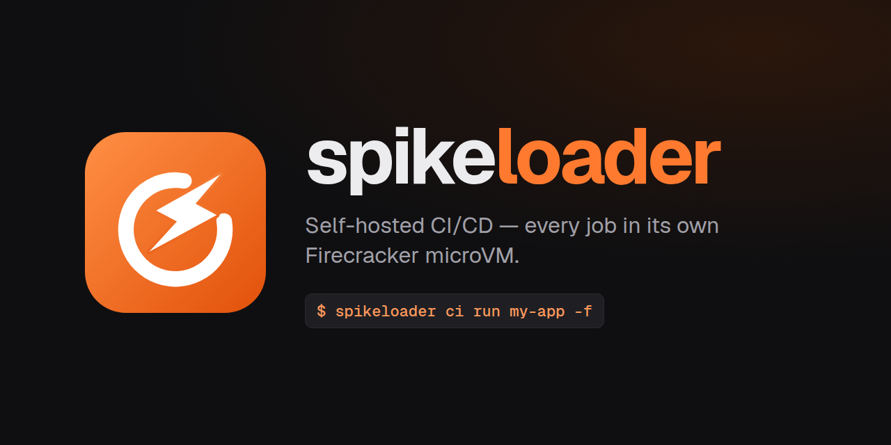

<p align="center"></p>

# spikeloader

**Self-hosted CI/CD where every job runs in its own Firecracker microVM — all inside a single VM.**

spikeloader runs your pipelines (builds, tests, security scanners, Docker builds, deploys) on your
Linux machine. Each job boots a fresh microVM with its own kernel, disk, network and **root**, runs
and is destroyed. Workspaces are isolated; only explicitly configured caches and artifacts
are transferred between jobs.

- **Hands-off infrastructure**: an Arch Linux VM with nested KVM hosts the microVMs, which boot
  Arch Linux on a recent mainline kernel (`GUEST_KERNEL`, built once on the host). It boots by itself
  when a job is queued, fits as many jobs as its CPU and memory allow, and stops when idle.
- **Pipelines in the repository** (`.spikeloader.yml`): stages, DAG, matrix, cache, artifacts,
  secrets, manual approvals, retries, templates and custom images — see [docs/ci.md](docs/ci.md).
- **Web panel** with live job logs, the stage graph, approvals, artifacts and secrets, plus a shell
  into any running job for debugging; installable as an app (PWA) and protected by a token.
- **`spikeloader` CLI** for everything the panel does (`spikeloader ci …`).
  The CI client is Go; Node is needed only for the web UI.
- **Fast and light**: a job's microVM is ready in a few seconds and uses ~100 MB of RAM on its own.
- **Secure by default**: panel only on `127.0.0.1`, token sessions, CSRF/DNS rebinding protection,
  secrets masked in logs, protected-branch secret policies, and bounded job logs.

## Requirements

- Linux x86_64 with KVM and **nested virtualization** (`cat /sys/module/kvm_{intel,amd}/parameters/nested` → `Y`/`1`)
- Your user in the `kvm` and `docker` groups (Docker runs the database, builds the microVM kernel and,
  without a native QEMU, the outer VM)
- Node.js ≥ 20.9 with npm (web UI), `make`, `ssh`/`scp`, `curl`, `git`
- Go ≥ 1.25 to build the daemon and guest agent — optional: without it they are built in the `golang` Docker image
- At least 12 GiB host RAM for the default 8 GiB outer VM plus the host services;
  reduce `.env` sizes or increase host memory for larger workloads
- At least 10 GB free disk (20 GB or more recommended for images/builds) and internet access

Run one installation per Linux host. Docker containers, volumes and default ports have fixed
names. This is a single-operator system for trusted repositories, not a shared runner service.

`spikeloader doctor` checks all of this.

## Installation

```bash
git clone https://github.com/spikeloader/spikeloader.git
cd spikeloader
cp .env.example .env
# Review .env resource sizes and ports before setup.
./bootstrap.sh --k3s
make up
```

Then run `bin/spikeloader web url` in another terminal and open the generated sign-in link.
Do not share that link: it contains your access token.

For automatic startup, use `./bootstrap.sh --k3s --service` instead of `make up`
(requires a working systemd user session). The foreground mode does not require systemd.
Bootstrap creates `.env` from `.env.example` if missing and never overwrites existing settings.
On Arch Linux, install host tools with `pacman` (`docker`, `nodejs`, `npm`, `git`, `openssh`,
`curl`, `make`; optionally `go`, `qemu-system-x86`, `qemu-img`, `cloud-utils`).
Docker and nested KVM must already be enabled and accessible to your non-root user.
The prerequisites are checked, not installed or elevated by the setup script.

`bootstrap.sh` is idempotent (run it again to update) and installs nothing with sudo — **do not run
spikeloader with sudo**. It:

1. runs `spikeloader doctor` and stops with fixes if a prerequisite is missing;
2. installs and builds the web panel, links `spikeloader` into `~/.local/bin` and creates the access token;
3. starts PostgreSQL (`spikeloader-postgres` container);
4. builds the microVM kernel (`GUEST_KERNEL`, a few minutes once; `--no-kernel` leaves it to the first job);
5. with `--k3s`: a local Kubernetes (`spikeloader-k3s`) and plain-HTTP registry (`spikeloader-registry`,
   port 5000) on the Docker bridge, with the admin kubeconfig in `~/.kube/spikeloader-k3s.yaml`
   (shown on the Infrastructure page; `make k3s-reset` recreates the cluster);
6. with `--service`: the panel as a systemd user service.

The kernel builder adapts Firecracker's disabled lockup/hung-task panic settings to numeric zero
when newer kernels define them as integers; older boolean definitions remain unchanged.

## Daily use

```bash
spikeloader web url                                      # link that signs you in to the panel
spikeloader ci add my-app git@github.com:me/my-app.git   # any git URL (HTTPS, SSH, file://)
spikeloader ci run my-app -f                             # run the default branch and follow the logs
spikeloader ci lint                                      # validate ./.spikeloader.yml
```

New commits start runs by themselves (polling or webhook). The first run boots and provisions the
outer VM (~2-3 min the very first time, ~20 s afterwards) and builds the images it needs.

```yaml
# .spikeloader.yml
jobs:
  build:
    stage: build
    image: node
    cache: { key: npm, files: [package-lock.json], paths: [node_modules] }
    steps: [npm ci, npm run build]
    artifacts: [dist/]
  test:
    image: node
    matrix: { shard: ["1", "2"] }
    steps: [npm test -- --shard=$MATRIX_SHARD/2]
  scan:
    stage: scan
    uses: scanners/trivy
  deploy:
    stage: deploy
    manual: true
    when: { branches: [main] }
    secrets: [SSH_PRIVATE_KEY]
    uses: deploy/ssh
    with: { host: app.example.com, path: /srv/app }
```

Images (`base`, `node`, `python`, `go`, `docker`, `security`) and templates (Trivy, Gitleaks,
Semgrep, Docker build, SSH deploy) are plain files you can override per repository. Full reference:
**[docs/ci.md](docs/ci.md)**.

### Web panel

`spikeloader web start` (or the service) serves it at http://127.0.0.1:4100; in Chrome/Edge use
**Install app** to get it as an application.

| Screen | What it has |
|--------|-------------|
| Pipelines | projects, runs (filterable), pipeline validator, images & templates, global secrets |
| Project | runs, branches, settings and notifications, secrets, push webhook |
| Run | stage graph, approvals, retries, live job logs with steps, artifacts, raw log download |
| Infrastructure | Kubernetes cluster (`K8S_KUBECONFIG` in .env): workloads, pods, warnings, nodes, namespaces; runners: outer VM state and capacity, the microVM of each running job, events, configuration, maintenance |
| microVM | root terminal, serial console, run commands and Firecracker API of a running job (debugging) |

## CLI reference

For a complete local Git → image build/push → k3s deployment example, see
[examples/k3s-demo](examples/k3s-demo/README.md). Initialize it as an independent demo repository with
a Go application, namespace-scoped deploy credentials and an ingress at `demo.localhost:8081`.

```
spikeloader ci ls | add | rm | hook | fetch | run | runs | show | logs | cancel | rerun | retry | approve | lint | secret | images
spikeloader web start | url | token [--rotate] | service install|uninstall|status|logs
spikeloader status [--json] | vm ls | vm ssh <id> [cmd...] | vm console <id> [lines] | shell
spikeloader down [--purge] | doctor | version
```

There is no command to create VMs: the CI engine creates the outer VM and one microVM per job.
`vm ssh`/`vm console`/`shell` are for debugging running jobs; `down` stops the outer VM right away
(maintenance — the next job starts it again).

## Configuration

[.env.example](.env.example) documents the defaults. Your ignored local `.env` holds the outer VM size and backend (`auto|native|docker`), Firecracker and guest
versions, and the CI policy:

| Variable | Default | Purpose |
|----------|---------|---------|
| `CI_MAX_JOBS` | `0` | parallel jobs; `0` = as many as fit (outer VM RAM minus 1 GiB, vCPUs overcommitted 2×) |
| `CI_IDLE_SHUTDOWN_MIN` | `30` | stop the outer VM after this many minutes without jobs (`0` = keep it running) |
| `CI_KEEP_RUNS` | `50` | runs kept per project |
| `CI_MAX_LOG_MB` | `50` | retained log per job in MiB (1-1024); truncates without stopping execution |

Outer VM changes apply the next time it starts. Panel variables:

| Variable | Default | Purpose |
|----------|---------|---------|
| `SPIKELOADER_PORT` / `SPIKELOADER_HOST` | `4100` / `127.0.0.1` | panel address (a non-loopback host is reachable from the network: use TLS in front) |
| `SPIKELOADER_TOKEN` | file `.lab/web-token` | pins the token via environment variable |
| `SPIKELOADER_ALLOWED_HOSTS` | — | extra accepted hosts (e.g. behind a reverse proxy) |
| `SPIKELOADER_AUTH` | `on` | `off` disables sign-in (refused unless the panel listens on loopback) |
| `SPIKELOADER_ROOT` | repo directory | installation root |

## Security

The panel runs commands as **root** inside the outer VM and the microVMs, so:

- it listens only on `127.0.0.1`; routes and the WebSocket reject non-local `Host`/`Origin`
  (blocks CSRF, DNS rebinding and WebSocket hijacking);
- every page, route and terminal requires a session (or the bearer token, for the CLI). The token
  (`.lab/web-token`, mode 600) yields a 30-day `HttpOnly`/`SameSite=Strict` cookie;
  `spikeloader web token --rotate` ends every session;
- only `/api/ci/hooks/<project>` is meant to be reachable from outside (through a tunnel), and it
  only accepts the project's webhook token.

Inside the outer VM, Firecracker runs as root **without the jailer**: the security boundary is the
outer VM itself. Only build repositories you trust (not pull requests from forks of public projects).

## Architecture

```
 Linux host (nested KVM)
 ├── spikeloaderd :4100 (Go) ── API · auth · CI engine (queue, scheduler, git mirrors) ──ssh──┐
 │     ├── PostgreSQL (container)          projects, runs, secrets (encrypted), events       │
 │     └── Next.js UI :4110 (supervised)   pages, proxied by the daemon                       │
 ├── spikeloader CLI ── API                                                                    │
 └── outer VM "spikeloader-host" (started/stopped by the engine)  ◀───────────────────────────┘
     │   Arch Linux · QEMU/KVM · fcctl · Firecracker · NAT · CI images
     ├── vm1  run #12 · build        (destroyed when the job ends)
     ├── vm2  run #12 · test (unit)
     └── vmN  …
```

| Part | Where | Role |
|------|-------|------|
| [cmd/spikeloaderd/](cmd/spikeloaderd/) | host | the daemon (Go): starts everything below, supervises the UI |
| [cmd/fcagent/](cmd/fcagent/) | outer VM | root Unix-socket agent: inspection, SDK/netlink lifecycle, images, exec and recoverable jobs |
| [internal/ci/](internal/ci/) | host | CI engine: pipeline parser, triggers, DAG, queue, capacity, executor, outer VM lifecycle |
| [internal/api/](internal/api/) | host | HTTP API, sign-in, CI webhooks, terminal WebSocket, proxy to the UI |
| [internal/](internal/) | host | `db` (PostgreSQL), `jobs` (events), `lab` (outer VM state), `k8s` (cluster view), `sshx`, `auth`, `env` |
| [web/](web/) | host | Next.js web UI only (no server code): talks to the daemon's API |
| [bin/](bin/) | host | operator launcher; CI commands exec the Go client in [cmd/spikeloader/](cmd/spikeloader/) |
| [host/](host/) | host | starts/stops the outer VM (native QEMU or in a container) |
| [host/kernel.sh](host/kernel.sh) | host | builds the microVM kernel (`GUEST_KERNEL`) once in an Arch container, cached in `.lab/kernel/` |
| [host/agent.sh](host/agent.sh) | host | builds the static Linux/x86_64 agent, uploaded alongside the kernel |
| [guest/setup.sh](guest/setup.sh) | outer VM | installs Firecracker and the kernel, builds the Arch rootfs (pacstrap), networking and NAT |
| [guest/fcctl](guest/fcctl) | outer VM | legacy operator debugging CLI and interactive SSH; CI uses the Go agent |
| [ci/](ci/) | — | built-in images (`ci/images/*.sh`) and templates (`ci/templates/**/*.yml`) |
| [brand/](brand/) | — | icon, banner and brand guide |

Provisioning installs `fcagent.service` with a root:lab 0660 Unix socket and no new network port.
After bundle preparation, jobs belong to the agent and survive daemon restarts: the daemon
reattaches to the same attempt and reconstructs its complete masked log and step state.
Preparation interrupted before agent ownership still fails explicitly and can be retried.
See [docs/backend.md](docs/backend.md#outer-vm-agent) for recovery details.

Platform records (projects, secrets, runs, events) live in PostgreSQL — the `spikeloader-postgres`
container, started by `spikeloader web start` / `make up` (`spikeloader db start|stop|status|psql`;
password in `.lab/pg-password`, `DATABASE_URL` overrides it). Local files live in `.lab/` (outer VM
disk, SSH keys, token, and git mirrors, job logs, artifacts and caches in `.lab/ci/`) and in
`/var/lib/fclab/` inside the outer VM (built images). Backend internals, the API contract and how to
extend them: **[docs/backend.md](docs/backend.md)**; what comes next: **[docs/roadmap.md](docs/roadmap.md)**. Internal `fclab` names (container
`fclab-outer`, image `fclab-qemu`) were kept for compatibility with existing installations.

## Operations

- **Local state**: `.lab/`, `.env`, UI dependencies and builds are not shipped or committed.
  Setup generates a private token, database password and SSH key per installation. Never delete
  `.lab/` while running: the VM disk depends on its base image, and losing `.lab/secrets.key`
  makes existing encrypted secrets unreadable. Keep the checkout at its installed path; the
  CLI symlink, service and VM disk backing paths refer to it.
- **Update**: `git pull && ./bootstrap.sh`, then restart the panel (`spikeloader web service install` again
  or restart `spikeloader web start`). Guest changes apply the next time the outer VM starts.
- **Uninstall**: first stop the foreground daemon, or run `spikeloader web service uninstall`.
  Then run `spikeloader down --purge`, remove the `~/.local/bin/spikeloader` symlink and,
  after backing up anything needed, remove the checkout. PostgreSQL, k3s and registry Docker
  containers/volumes are intentionally retained; remove only those named resources if you
  also want to erase platform records, workloads and registry images. Never use a global Docker prune.
- **Backup**: `docker exec spikeloader-postgres pg_dump -U spikeloader spikeloader > backup.sql` for
  projects, runs and secrets, plus `.lab/secrets.key` (secrets are encrypted with it: without the key
  the dump's secrets are unreadable) and `.lab/ci/` for logs, artifacts and caches.

## Troubleshooting

- **`spikeloader doctor` reports files with another owner**: something ran with sudo. `sudo chown -R $USER: .`
- **`/dev/kvm missing in the outer VM`**: nested is off on the host (`options kvm_amd nested=1` or
  `kvm_intel nested=1` in `/etc/modprobe.d/kvm.conf`, then reload the module).
- **Runs stay queued**: is the panel running? Check **Infrastructure → Events** for the outer VM
  start; its console is `.lab/console.log` (docker backend: `docker logs fclab-outer`).
- **A job's microVM never gets SSH**: the job log shows it; `spikeloader vm console <id>` while it runs.
- **Port in use**: `SPIKELOADER_PORT=4200 spikeloader web start`; outer VM SSH: `SSH_PORT` in `.env`.

To bring everything up (test k3s + database + daemon/panel): `make up`. Development: `make web-dev` (UI hot reload; the daemon is rebuilt from source when it changed) and `make test` (Go tests/vet, UI type check/lint); see [docs/backend.md](docs/backend.md). Version history in [CHANGELOG.md](CHANGELOG.md).

## Contributing and license

See [CONTRIBUTING.md](CONTRIBUTING.md) for development and validation, and
[SECURITY.md](SECURITY.md) for the trust model and vulnerability reporting.
Licensed under [Apache-2.0](LICENSE). Dependencies and downloaded VM images/toolchains
retain their own licenses; they are not included in the source checkout.
